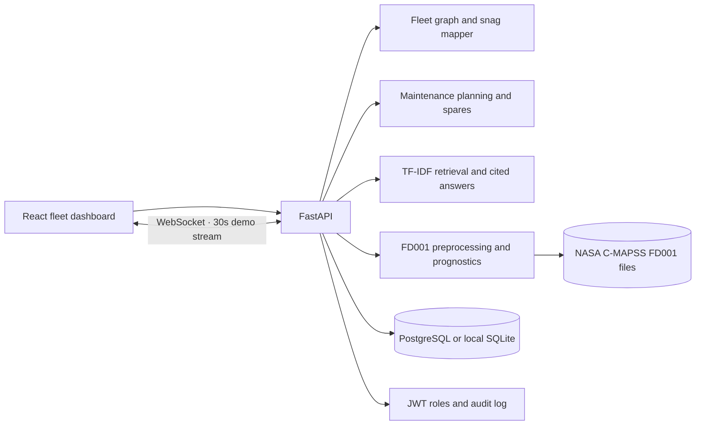

# AEROINTEL AI

The responsive dashboard is served by a FastAPI backend. Dashboard and analytics reads are available without signing in; record changes remain authenticated and role-protected. New installs do not automatically seed sample operational records. When demo seeding is disabled, startup removes only the exact sample records created by the built-in seed routine and preserves other database rows. The default backend stores records in a local SQLite file at the repository root. Run commands from the repository root; this keeps `.env` and relative SQLite paths anchored there. Configure `DATABASE_URL` with a Supabase PostgreSQL connection string to persist records there.

The main dashboard (`frontend/index.html`) and fleet dashboard (`frontend/fleet.html`) are served by the same FastAPI service. The main dashboard API client reads `window.AEROINTEL_CONFIG.apiBaseUrl`; `/api/client-config.js` supplies `PUBLIC_API_BASE_URL`. Leave it blank for same-origin hosting. If you deploy a dashboard on a separate static host, provide its API base URL there and set `FRONTEND_URL` to that site's origin. Keep credentials out of browser configuration.

## Deploy

The one-service container runs the FastAPI API and both dashboards on the same origin. It defaults to `APP_ENV=development`, SQLite at `/app/state/aerointel_demo.db`, and port `7860`. Sample operational records are not seeded unless `AUTO_SEED_DEMO_DATA=true` is explicitly set for a local demonstration. It needs no Supabase or PostgreSQL service. Keep `FRONTEND_URL` and `PUBLIC_API_BASE_URL` blank for same-origin behavior; CORS is not needed for same-origin browser requests.

### Hugging Face Spaces

1. Create a Space and choose **Docker** as its SDK.
2. Push this repository to the Space. The root `Dockerfile` serves port `7860`, and the README metadata configures the Space port.
3. In Space settings, add a strong `JWT_SECRET_KEY`. If it is empty, the entrypoint generates a random key at startup and logs only that it generated one. The demo uses local SQLite and needs no database credentials.
4. Open the Space URL. The dashboard is at `/`, the fleet view at `/fleet`, and health is at `/api/health`.

### Render

1. Create a **Web Service** from this repository and select the **Docker** runtime, using the root `Dockerfile`.
2. Set the health check path to `/api/health`.
3. Set `APP_ENV=development`, `DEMO_MODE=true`, `AUTO_SEED_DEMO_DATA=false`, `DATABASE_URL=sqlite:////app/state/aerointel_demo.db`, and a strong `JWT_SECRET_KEY` in the Render dashboard. Render supplies `PORT`; the image defaults it to `7860` for local and Spaces use.
4. Leave `FRONTEND_URL` and `PUBLIC_API_BASE_URL` blank when using the dashboard on the API's origin. No Supabase or PostgreSQL setup is needed for this demo.

Free tiers may sleep while idle, so the first request after inactivity can have a cold start.

## Run locally

1. Use Python 3.11 or newer.
2. Create and activate a virtual environment, then install dependencies:

   ```powershell
   py -3.11 -m venv .venv
   .\.venv\Scripts\Activate.ps1
   pip install -r backend/requirements.txt
   Copy-Item .env.example .env
   ```

3. Keep `AUTO_SEED_DEMO_DATA=false` for a clean local database. Set it to `true` only when you explicitly want fictional sample records in a local demonstration. Do not put real secrets in source control. Set `JWT_SECRET_KEY` to a random value of at least 32 characters before deploying.
4. Start the dashboard and API:

   ```powershell
   uvicorn backend.app.main:app --reload
   ```

5. Open <http://127.0.0.1:8000>. API documentation is at <http://127.0.0.1:8000/docs> in development. Health is at `/api/health`. Run the install, startup, and script commands from the repository root so `.env` and the default SQLite database stay there.

The optional demo seed inserts into empty tables only; it never deletes or replaces rows. The app does not run it automatically. To initialize sample rows explicitly, run `python -m backend.scripts.seed_demo` after setting `.env`.

### Start the local sample dashboard

The deployed/configured database and local SQLite demo database are separate. An empty configured database correctly returns empty records; the app does not copy or seed data across databases. On Windows, run `backend/scripts/run_local_demo.ps1` from the repository. It explicitly starts the dashboard against `aerointel_demo.db`, where fictional sample records are labeled `SYNTHETIC DEMO`, and seeds only empty tables. It does not rewrite `.env` or connect to the configured PostgreSQL database. Open <http://127.0.0.1:8000> (do not open `frontend/index.html` as a `file://` page, because API calls need the FastAPI origin). Stop the local server with Ctrl+C.

The dashboard separates these sample records from the **Public Fleet Estimates**, **Official Government Disclosures**, and **Official References** pages. Government sources are background references; they do not verify operational aircraft, crew, maintenance, or schedule records. Never seed synthetic records into production. Add reviewed operational records only through an authorized workflow in the configured database.

## Public Indian military aviation inventory estimates

The dashboard's **Public Fleet Estimates** view uses the supplied October 10, 2026 open-source snapshot in `data/india_military_aircraft_2026_10_10.json`. It is an imported reference dataset, not a live feed or official readiness report. It stays separate from the existing fictional `aircraft` table. The eight MQ-9B SkyGuardian aircraft on order are recorded as procurement and excluded from active inventory totals. The API exposes read-only public records at `/api/public-inventory` with optional `organization`, `category`, and `model` filters.

For local SQLite, the table is created by the app and import can be repeated safely:

```powershell
python -m backend.scripts.import_public_inventory
```

For PostgreSQL/Supabase, inspect the schema and apply reviewed additive migration [`backend/migrations/003_public_inventory_estimates.sql`](backend/migrations/003_public_inventory_estimates.sql) first, grant the backend role select/insert/update on `public_inventory_records` plus sequence access, and add the dedicated-role RLS policy. Then run the same importer. It upserts by the stable model/service/dataset-version key; it does not delete or replace records. The importer requires the intended database configured in `DATABASE_URL` and never creates application tables in PostgreSQL automatically.

The supplied row list sums to 1,699 Air Force aircraft versus the approximate headline of 1,700, 367 Army Aviation aircraft, and 287 Navy aircraft. Across services the rows sum to 2,353 versus the approximate headline of 2,350. These differences are reported by the API/UI rather than silently changing the source rows. The last two differences are ordinary rounding/approximation at this precision. Inventory estimates do not establish serviceability, availability, maintenance, crew, or live aircraft location; those values are unavailable in the supplied source and are not inferred from inventory.


## Official Government of India aviation disclosures

The **Official Government Disclosures** view is separate from inventory estimates and operational aircraft records. It contains dated facts from Ministry of Defence / Press Information Bureau publications, including procurement approvals and contracts for LCA Mk1A, LCH Prachand, and C-295MW. The API serves the reviewed, versioned snapshot at `/api/official-disclosures`; it does not merge contract quantities into current fleet totals. Quantities represent the event described by each release (approval or contract), not delivered aircraft, active strength, or readiness. Each record links to its original PIB publication. The exact active fleet strength is not represented here: the Government stated in a Rajya Sabha answer that disclosing types and strength was not in the interest of national security ([Rajya Sabha debate, 28 March 2012](https://cms.rajyasabha.nic.in/UploadedFiles/Debates/OfficialDebatesDatewise/Floor/225/F28.03.2012.pdf)).

The source data is `data/india_official_aviation_disclosures_2026_10_18.json`. Update it only after reviewing a primary government publication, preserve the publication date and URL, and increment `dataset_version`. Do not use these order/approval quantities to calculate active aircraft inventory.

## Supabase PostgreSQL

1. Set `DATABASE_URL` locally to the PostgreSQL connection URI from the Supabase **Connect** panel. This is the database URI, not the Supabase project URL or a publishable/secret API key. The app accepts `postgresql://`, `postgres://`, and `postgresql+psycopg://` forms and uses Psycopg 3. URL-encode reserved characters in credentials. Keep the URI in the ignored local `.env` file or environment, never in source control.
2. Before changing an existing database, run the read-only inspector:

   ```powershell
   python -m backend.scripts.inspect_database
   ```

   It reports tables, columns, types, nullability, primary/foreign/unique keys, indexes, row counts (without reading row contents), model drift, and PostgreSQL RLS policies. It never creates, updates, or deletes data. Review this output against the application models before applying any schema change. The existing operational tables may have columns different from this application's model, so do not run the fresh-database migration against the existing project without that review.
3. For a **completely fresh, empty database only**, apply these reviewed SQL files in order: [`backend/migrations/001_initial_schema.sql`](backend/migrations/001_initial_schema.sql), [`backend/migrations/003_public_inventory_estimates.sql`](backend/migrations/003_public_inventory_estimates.sql), [`backend/migrations/004_weather_provenance.sql`](backend/migrations/004_weather_provenance.sql), then [`backend/migrations/005_normalized_identifier_uniqueness.sql`](backend/migrations/005_normalized_identifier_uniqueness.sql). Migration `001` already creates `profiles`, `audit_logs`, and `analysis_reports.generated_by`, so `002` is not needed for a fresh database. `003` creates the tenth app table. Before `005`, verify there are no duplicate aircraft or crew IDs after trimming and case folding.
4. For an **existing database**, never run `001`. Inspect it first and compare the actual schema with the models. Apply only reviewed missing pieces: use `002` only for absent auth/audit support or the nullable report ownership column; `003` only if the inventory table is absent; `004` only if weather provenance columns/index are missing and after reviewing its `data_type` backfill and duplicate weather keys; and `005` only after checking normalized aircraft/crew IDs for duplicates. These files do not provide a migration ledger, and `CREATE TABLE IF NOT EXISTS` does not repair a pre-existing table with a different layout. Do not delete records to make a migration succeed.
5. Create a dedicated Postgres login for the API with `NOBYPASSRLS` (do not use the Supabase `service_role` key or database owner for routine API traffic). In a privileged SQL session, create the role and grant only the needed access:

   ```sql
   create role aerointel_backend login nobypassrls;
   grant connect on database postgres to aerointel_backend;
   grant usage on schema public to aerointel_backend;
   grant select, insert, update, delete on profiles, aircraft, crew, maintenance_records,
     weather_observations, schedule_records, alerts, analysis_reports, audit_logs, public_inventory_records to aerointel_backend;
   grant usage, select on all sequences in schema public to aerointel_backend;
   ```

   Set its password through the Supabase dashboard/secure shell, not in this repository. Use your actual database name if it differs from `postgres`.
6. In SQL Editor, create an RLS policy for that trusted API role on each table. Example after creating the role `aerointel_backend`:

   ```sql
   create policy api_profiles on profiles to aerointel_backend using (true) with check (true);
   create policy api_aircraft on aircraft to aerointel_backend using (true) with check (true);
   create policy api_crew on crew to aerointel_backend using (true) with check (true);
   create policy api_maintenance on maintenance_records to aerointel_backend using (true) with check (true);
   create policy api_weather on weather_observations to aerointel_backend using (true) with check (true);
   create policy api_schedules on schedule_records to aerointel_backend using (true) with check (true);
   create policy api_alerts on alerts to aerointel_backend using (true) with check (true);
   create policy api_reports on analysis_reports to aerointel_backend using (true) with check (true);
   create policy api_audit on audit_logs to aerointel_backend using (true) with check (true);
   create policy api_public_inventory on public_inventory_records to aerointel_backend using (true) with check (true);
   ```

   These policies authorize only the trusted backend database login. The API applies user roles and authorization before writes. Never expose the database URL or any Supabase key to the browser.
7. The dedicated login's PostgreSQL URL is the `DATABASE_URL` used by the backend; SQLAlchemy selects the psycopg 3 driver. Optional `SUPABASE_URL`, `SUPABASE_PUBLISHABLE_KEY`, and `SUPABASE_SECRET_KEY` are placeholders for future Supabase Auth/client use; the backend database connection uses `DATABASE_URL`.
8. Do not run the demo seed script against production. It is only for a local fictional dataset.

Production startup requires `APP_ENV=production`, `DEMO_MODE=false`, a strong `JWT_SECRET_KEY`, PostgreSQL, and all ten tables used by the app. Production startup does not run `create_all` or seed data; it checks required tables, columns, and the weather/normalized-ID uniqueness indexes and exits with a clear error when setup is incomplete. The inspector also checks model index names; `001` currently names the schedule composite index `ix_schedule_starts_status` while the model expects `ix_schedule_records_starts_status`, so review this reported naming drift rather than assuming the indexes match by name. Apply only reviewed migrations before deployment.

After the schema matches and the runtime role has the required grants and RLS policies, run `python -m backend.scripts.test_postgres_connection`. It verifies required tables/columns and runs a `SELECT 1`, then inserts and reads a marker only in a PostgreSQL temporary table inside a transaction that it rolls back. It refuses to run on SQLite or in demo mode and does not touch application rows. Restart the API separately and verify `/api/health` plus an authenticated dashboard request to check persistence end to end.

## Environment settings

See `.env.example`. `GEMINI_API_KEY` is server-only. `GEMINI_MODEL` selects the model. Without a key or if Gemini fails, analysis uses an explicitly labeled rule-based fallback. `OPEN_METEO_LATITUDE`, `OPEN_METEO_LONGITUDE`, and `OPEN_METEO_LOCATION` set the configurable weather location. Weather requests use Open-Meteo with timeout and in-memory caching. A provider outage shows saved Open-Meteo records as explicitly stale when available, or an unavailable state; it never substitutes demo readings. The default graph filters to `source=open-meteo`; demo observations are available only through the explicit `mode=demo` graph API. Each graph record includes its source, observation timestamp, data type, location coordinates, and available fetch/creation timestamps. Forecast values are not physical sensor or aircraft measurements.

The shared API client connects the dashboard's summary, aircraft, crew, maintenance, schedule, alerts, activity, analytics, weather, AI analysis, authentication, and report screens to the `/api` routes. Write operations are persisted through the configured SQLAlchemy database. Role checks remain enforced by the API. Schedule creation and updates reject overlapping reservations with HTTP 409 and return conflict details to the dashboard.

## Synthetic ML Analytics

The **ML Analytics** dashboard view uses `data/aircraft_maintenance_demo.csv`, a supplied synthetic demonstration dataset labeled `SYNTHETIC_DEMO`. It is not real maintenance data and must not be used to assess aircraft safety, readiness, or operational suitability. The exact banner **SYNTHETIC DEMO DATA — NOT FOR OPERATIONAL USE** appears anywhere ML results are presented.

Model preprocessing, training, holdout evaluation, and inference run in the Python backend. The fixed stratified 80/20 split uses `random_state=42`; `record_id`, `data_origin`, and the target are excluded from model inputs. Training produces a scikit-learn preprocessing/classifier pipeline, accuracy, macro and per-class precision/recall/F1, class support, and a confusion matrix. The API never trains implicitly. To explicitly train or refresh the ignored local artifact, run from the repository root:

```powershell
python -m backend.scripts.train_maintenance_model
```

The generated `backend/models/maintenance_demo.joblib` is ignored by Git. The runtime verifies that its recorded dataset SHA-256 matches the current CSV; missing, invalid, or stale artifacts are reported as unavailable. APIs are `GET /api/ml/status`, `GET /api/ml/dataset-summary`, `GET /api/ml/evaluation`, and `POST /api/ml/predict`; all require authentication. AI Decision Support retrieves ML results through backend functions and returns deterministic verified figures for ML questions; it does not pass those questions to Gemini or fabricate results. Its ML responses are explicitly marked as backend ML analytics.

The Docker image trains `maintenance_demo.joblib` from the supplied CSV at build time. This keeps the classifier available after deployment even though its generated local artifact is not tracked by Git.

The AI Decision Analyzer routes greetings, thanks, empty input, and unrelated questions before loading the dashboard snapshot or calling Gemini. Relevant questions use a fresh backend-generated snapshot; client-provided metrics are ignored. Simple aircraft count, availability, and readiness questions lead with a direct answer calculated from that snapshot, followed by the related metrics. Calculated values include their backend basis and snapshot timestamp in the response. Each response labels its source (`Gemini AI`, `Rule-based fallback`, or `Intent handler`) and reports whether Gemini was configured and actually used; a rule-based response never claims that Gemini was used. Missing snapshot values are reported as unavailable rather than inferred. No new configuration is required.

The ML Analytics view checks `/api/health`, `/api/ml/status`, `/api/ml/dataset-summary`, and `/api/ml/evaluation` and labels unavailable data instead of substituting zeros. The prediction form accepts only categories present in the checked dataset and the backend validates numeric ranges and artifact feature order. Prediction results include the model version but no confidence score because the synthetic Random Forest probabilities have not been calibrated. A prediction is a demonstration output, not a maintenance diagnosis or airworthiness decision.

## Dashboard metric definitions

Dashboard metrics are calculated from stored administrative records. Local seeded aircraft and crew are fictional demonstration records and do not represent verified real-world readiness.

- Aircraft readiness confirmation = records whose `readiness_confirmation` is true / unique aircraft records with an explicit boolean confirmation. The summary keeps this separate from availability.
- Aircraft availability = unique aircraft with `availability_status=available` / unique aircraft with one of the recognized availability statuses (`available`, `maintenance`, `standby`, `unavailable`).
- Aircraft status shares = count in each recognized availability state / that same recognized-status denominator. “Not standby” is a status complement (available + maintenance + unavailable), not resource utilization.
- Crew readiness = unique crew with `readiness_status=ready` / unique crew with a recognized readiness status (`ready`, `review`, `unavailable`).
- Resource utilization is unavailable because the database does not store flight hours, sortie counts, or another usage measure; it is not inferred from standby status.
- Open maintenance counts `open`, `in_progress`, and `overdue` maintenance records. Schedule activity counts `scheduled` and `in_progress` schedule records. Open alerts count alerts whose status is `open`; severity totals use those same open alerts.

Aircraft and crew duplicates are normalized by trimmed, case-insensitive business ID and the latest `updated_at` / `confirmation_at` row is counted. Missing IDs are counted separately as individual records. Unknown or missing statuses do not enter status percentage denominators and are surfaced in data-quality counts. Percentages round to the nearest whole percent, with exact halves rounded up. Empty denominators return unavailable (`null`), not zero.

SQLite creates required tables and these indexes on startup. Before PostgreSQL deployment, inspect duplicates and apply the reviewed SQL migrations in order, including `004_weather_provenance.sql` and `005_normalized_identifier_uniqueness.sql`. This project currently has no migration ledger, so schema checks cannot prove which historical SQL files were applied; verify required columns and indexes directly. Never delete duplicate or legacy audit rows automatically to make a unique index apply.

Self-registration creates viewer accounts only. Assign `admin` or `analyst` to a profile through a trusted administrator-controlled database action; never accept a role from the registration request. Access tokens are short lived. Logout is stateless: the client discards its bearer token. Dashboard reads, analytics, fleet services, and writes require authentication in every mode. Elevated writes require analyst/admin. Reports are visible to their creator; admins can review all reports.

Sensitive-route throttling is in-process and protects against simple repeated attempts. For a multi-instance production deployment, also apply edge/API rate limits at the hosting layer.

## Tests

```powershell
python -m pytest -q
```

The suite uses an isolated temporary SQLite database for API, auth/role, source separation, provenance, and provider failure behavior checks. To test Open-Meteo or Gemini against the real services, configure the corresponding environment secret and exercise `/api/weather/forecast` or log in and call `/api/ai/analyze` from Swagger; external API calls are not required by the local test suite.

## Render deployment

- Use the Docker web service steps in [Deploy](#deploy). The root Dockerfile reads Render's `PORT`, and `/api/health` is the health check path.

## Vercel not supported

Vercel is not a deployment target for this application. The Python dependency bundle is approximately 577 MB, exceeding the intended function bundle size; use the Docker deployment on Hugging Face Spaces or Render instead.

## Credential rotation

Never commit `.env` or include it in a ZIP/archive. Keep real credentials in the deployment dashboard or ignored local environment file. If a credential was previously exposed, revoke/rotate it in its provider dashboard, update the deployment environment, and remove it from Git history as appropriate.
# Fleet Intelligence extension

The existing AEROINTEL application now includes a fictional fleet intelligence demo at `/fleet` and a FastAPI extension for snag mapping, fleet graph queries, planning, prediction, and maintenance copilot retrieval. Sample work orders, depots, spares, manuals, aircraft and snags are synthetic and must not be treated as operational records.

## Architecture



## Quick demo

Run `make demo` (or `docker compose up --build`) and open [http://localhost:8000/fleet](http://localhost:8000/fleet). Open the dashboard to browse read-only data without signing in. Sign in only for protected actions. Fleet graph and planning results remain synthetic examples and must not be used as operational assessments.

`python -m backend.scripts.show_snag_mappings` prints five noisy snag mappings and similarity scores. `python -m backend.scripts.simulate_maintenance` prints deterministic before/after fictional availability and AOG KPIs.

## FD001 training and evaluation

To download and train from PowerShell in the repository root:

```powershell
New-Item -ItemType Directory -Force data/CMAPSSData
Invoke-WebRequest -Uri https://data.nasa.gov/docs/legacy/CMAPSSData.zip -OutFile data/CMAPSSData.zip
Expand-Archive -Path data/CMAPSSData.zip -DestinationPath data/CMAPSSData -Force
python -m backend.scripts.train_fd001
```

The loader validates the 26-column sensor format; preprocessing smooths each unit's sensor streams and flags abrupt changes. Training saves `backend/models/fd001_prognostics.joblib` and prints test-set RMSE and the asymmetric NASA score. The API reports the saved metrics at `/predict/metrics`; `/predict/rul` and `/predict/anomaly` accept JSON shaped as `{"sensors":{"sensor_01":0.0}}` and return intervals and the top three sensor attributions. Intervals are empirical calibration bands. SHAP is used when its installed explainer supports the fitted tree; a standardized-deviation attribution is the fallback.

The official catalog ZIP is available from the [NASA C-MAPSS dataset record](https://catalog.data.gov/dataset/cmapss-jet-engine-simulated-data). FD001 training completed on the official train/test/RUL files: **RMSE 18.51 cycles**, **NASA score 1,048.52**, over **100 test engines**. The compact trained artifact is saved at `backend/models/fd001_prognostics.joblib` and tracked by Git; the downloaded raw data remains git-ignored. Missing data produces a clear error rather than substituting synthetic records.

## API highlights

- `GET /graph/aircraft/{id}` returns the tail, components, snags, work orders, and spares in the demo graph.
- `POST /planning/expected-aog-days`, `/planning/bundle`, and `/planning/what-if` calculate demo planning scenarios. Bundling uses OR-Tools CP-SAT when installed and a priority-aware fallback otherwise.
- `GET /planning/spares` returns low-stock recommendations.
- `POST /copilot/ask` returns a context answer, source IDs, and similar cases. `RAG_PROVIDER=local` uses local TF-IDF retrieval; `ollama` uses `OLLAMA_URL` and `OLLAMA_MODEL`; `api` uses `RAG_API_URL`, `RAG_API_KEY`, and `RAG_API_MODEL`.
- `GET /copilot/evaluation` runs a fixed set of 15 retrieval questions.
- `WS /ws/fleet` streams fleet refreshes and a rotating synthetic fault every 30 seconds in demo mode.

## Operations dashboard data

The operations dashboard reads saved aircraft, crew, maintenance, schedule, alert, and report rows from the configured database. `GET /api/public-aviation-data` is a best-effort public feed: airport METARs come from aviationweather.gov and OpenSky is reduced to a coarse India-region aircraft count. Both providers are cached, time-limited, retried once, and allowed to fail without breaking dashboard requests; the endpoint then includes a clearly labeled synthetic fallback from saved sample weather and schedule records. These live public observations are not linked to individual fleet records.

For local development only, `python -m backend.scripts.seed_dashboard_demo` creates or refreshes repeatable sample rows on a SQLite database when `APP_ENV` is non-production and `DEMO_MODE=true`. Crew identities, registrations, operational status, airports assigned to aircraft, maintenance, schedules, and alerts are synthetic and are stored with `is_demo=true`; fictional names are used. Public inventory contributes aircraft type labels and aggregate estimates only. The script refuses PostgreSQL and production configurations. Do not use sample records for safety, dispatch, or airworthiness decisions.

For a local PowerShell session, set `APP_ENV=development`, `DEMO_MODE=true`, and `DATABASE_URL=sqlite:///./aerointel_demo.db` before running the seed command. The script uses its own stable `SAMPLE-*` identifiers, so the legacy cleanup for older `DEMO-*` fixtures leaves these rows intact. For a production PostgreSQL database, first apply `backend/migrations/006_dashboard_demo_fields.sql`, then explicitly opt into sample records with `python -m backend.scripts.seed_dashboard_demo --allow-production`. This option is never used automatically. Production connectivity was unavailable during this task, so no production migration or seed was run.

## Roles, audit, and compose

The dashboard reflects the existing `viewer`, `analyst`, and `admin` roles. Existing authentication uses JWT; successful prediction, copilot, and scenario calls write audit events for authenticated users. Set `JWT_SECRET_KEY` in `.env` before deployment. Docker Compose uses a persistent SQLite database for the safe local demo; configured PostgreSQL remains available for deployments through `DATABASE_URL`. Start the optional Ollama service with `docker compose --profile local-llm up --build` and set `RAG_PROVIDER=ollama` to use it.

Run the requested suite with `python -m pytest -q`.
